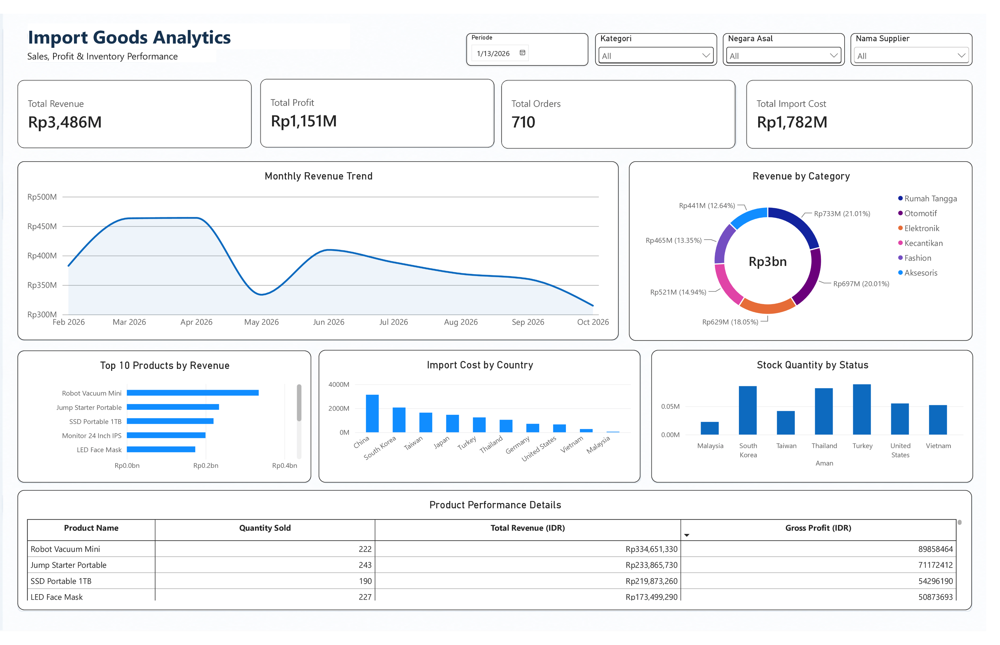

# Import Goods Analytics

An interactive Power BI dashboard project designed to analyze import costs, sales performance, revenue trends, and inventory across products, suppliers, and countries.

## Project Overview

## Dashboard Preview



This project focuses on analyzing import and sales data to gain insights into business performance. The dashboard provides an overview of key metrics and interactive visualizations to support data-driven decision-making.

## Objectives

- Analyze overall revenue and profit performance.
- Monitor monthly revenue trends.
- Identify the highest-performing product categories and products.
- Analyze import costs by country of origin.
- Monitor inventory quantities by stock status.
- Explore business performance using interactive filters.

## Tools & Technologies

- **Microsoft Excel** – Data preparation and organization.
- **Microsoft Power BI** – Data visualization and dashboard development.
- **DAX** – Data calculations and measures.

## Dashboard Features

| Visualization | Analysis |
|---|---|
| KPI Cards | Total Revenue, Total Profit, Total Orders, and Total Import Cost |
| Line Chart | Monthly Revenue Trend |
| Donut Chart | Revenue by Category |
| Bar Chart | Top 10 Products by Revenue |
| Bar Chart | Import Cost by Country |
| Bar Chart | Stock Quantity by Status |
| Matrix | Product Performance Details |

## Interactive Filters

The dashboard includes interactive slicers to explore the data by:

- Period
- Product Category
- Country of Origin
- Supplier

## Repository Structure

```text
import-goods-analytics/
│
├── Dataset/
│   └── Import_Goods_Analytics.xlsx
│
├── PowerBI/
│   └── Import_Goods_Analytics.pbix
│
├── Screenshots/
│   └── dashboard-preview.png
│
└── README.md
```

## Key Skills Demonstrated

- Data Cleaning & Preparation
- Data Analysis
- Data Visualization
- DAX Measures
- Dashboard Development
- Business Intelligence

## Dashboard Preview

*Dashboard screenshot will be added here.*

## Project Status

Completed – Dashboard development and visualization.

---

**Note:** This is a portfolio project created for learning and demonstrating data analytics skills.
